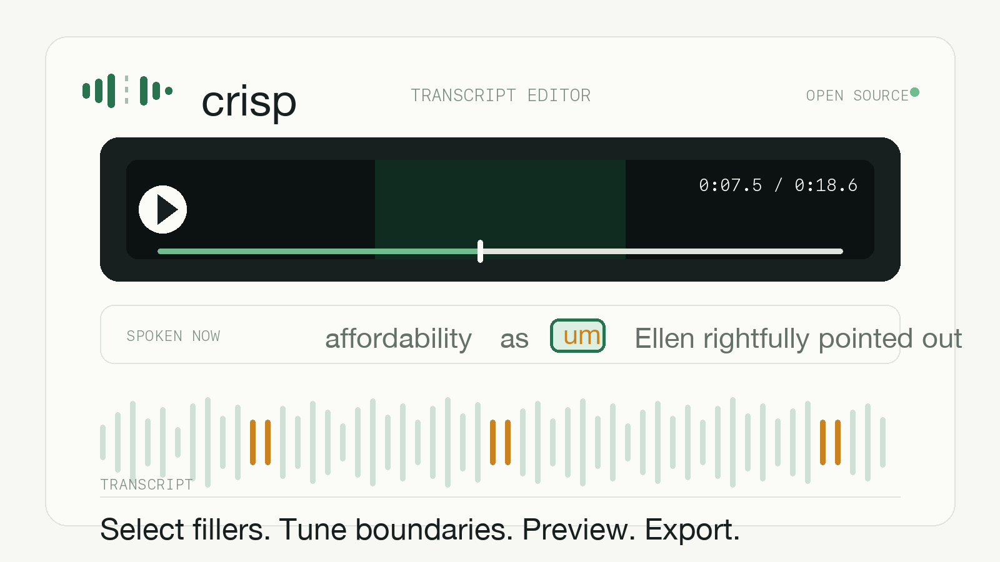

<p align="center">
  
</p>

<h1 align="center">Crisp</h1>

Crisp is a local transcript-based audio and video editor prototype. It lets a user import media, transcribe it, select words in the transcript, preview edits, and render a cleaned audio/video copy.

The current prototype focuses on filler-word cleanup and timestamp-based editing.

<p align="center">
  
</p>

<p align="center">
  <video src="./demo/crisp-demo.mp4" controls muted width="100%" title="Crisp demo video"></video>
</p>

## Features

- Import audio or video.
- Extract audio from video for transcription.
- Transcribe media with Groq Whisper.
- Display word-level transcript timestamps.
- Highlight filler candidates such as `um`, `uh`, `ah`, `erm`, and `hmm`.
- Select transcript words.
- Preview selected edits.
- Render selected edits as:
  - `Silence`: mute the selected interval while preserving duration.
  - `Remove`: cut the selected interval and close the gap.
- Preserve the original upload until final download cleanup.

## Tech Stack

- Frontend: React + Vite + TypeScript.
- Backend: Node.js + Express + TypeScript.
- Transcription: Groq Audio Transcriptions API.
- Media processing: FFmpeg and FFprobe.

## Requirements

- Node.js
- npm
- FFmpeg available on `PATH`
- FFprobe available on `PATH`
- A Groq API key (create one at `console.groq.com`) — transcription fails
  without it. The landing page checks for it on load and tells you if it is
  missing.

## Environment

Create a `.env` file in the project root:

```bash
GROQ_API_KEY=your_groq_api_key_here
PORT=8787
```

The app reads `.env` through `dotenv`.

## Install

```bash
npm install
```

## Run

```bash
npm run dev
```

This starts:

- API: `http://localhost:8787`
- Web app: `http://localhost:5173`

## Build

```bash
npm run build
```

## Project Structure

```text
DESIGN.md
  Crisp visual identity used by the app and demo assets.

server/index.ts
  Express API, upload handling, Groq transcription, FFmpeg rendering.

src/App.tsx
  Main React editor UI.

src/BoundaryEditor.tsx
  Waveform panel for adjusting each cut by hand.

src/languages.ts
  Languages supported by Whisper large-v3, listed on the landing page.

src/styles.css
  Application styling.

Example Audio/
  Optional sample audio file.

demo/
  Public demo poster, demo video, and HyperFrames source composition.

data/uploads/
  Uploaded originals. Ignored by git.

data/proxies/
  Temporary transcription audio proxies and chunks. Ignored by git.

data/exports/
  Preview and final rendered files. Ignored by git.
```

## Current Workflow

1. Import an audio or video file.
2. Crisp stores the original upload.
3. For video, Crisp extracts/normalizes an audio proxy for transcription.
4. Crisp transcribes the media.
5. The transcript appears with word timestamps.
6. Filler candidates are highlighted.
7. User selects words.
8. User adjusts each cut's boundaries on the waveform if needed.
9. User chooses `Silence` or `Remove` (audio supports `Remove` only).
10. User previews the selected edit.
11. User prepares a final download.

## Rendering Model

Crisp uses non-destructive edit operations:

```json
{
  "id": "operation_001",
  "type": "ripple_delete",
  "source_start": 7.54,
  "source_end": 8.021,
  "word_ids": ["word_0024"],
  "boundary_source": "user_adjusted"
}
```

The original transcript timestamps are kept as source-media timestamps. Rendering is done from the original media file into a generated copy.

Current render paths share the same backend function:

```text
/api/projects/:id/preview
/api/projects/:id/render
/api/projects/:id/finalize
```

## Important Limitation

Word timestamps are not always safe cut boundaries.

ASR can mark a filler word in a way that overlaps nearby real speech. If Crisp removes that interval exactly, it can remove part of a real word. This is why every cut is adjustable by hand before rendering.

Example:

```text
participating, um, in
```

The provided timestamp may mark `um` too early, causing a cut to remove part of `participating`.

This is the main known product limitation. Internal timestamp/debug notes are
kept out of the public repository.

## Transcription

Whisper cleans up speech by default and omits filler words entirely, folding
them into the neighbouring word's timing. Crisp counters this by passing a
`prompt` of deliberately disfluent speech, which acts as a style prior rather
than an instruction — *demonstrating* the style works where describing it
("keep every um") does not.

Measured on the bundled samples: zero fillers without the prompt, all three
with it, identical across repeated runs. It also improves the surrounding
transcript, recovering the repeated `access access` and `Ellen` (unprompted
runs produced `Alan`).

Set `WHISPER_PROMPT` in `.env` to tune it for a different speaker or language.

Whisper large-v3 transcribes 100 languages (the full list is on the landing
page), though accuracy varies considerably between them. The default prompt
above is English, so for another language set `WHISPER_PROMPT` to a sample of
disfluent speech in that language or fillers will go undetected.

## Boundary Adjustment

Because word timestamps are only ever an approximation, every selected word can
be adjusted by hand before rendering. Selecting a word opens an editor showing
the real waveform around it:

- Drag either edge of the cut, or nudge with `←` / `→` (10ms, or 50ms with Shift).
- Dashed guides mark where the neighbouring words start and end.
- `Play selection` plays exactly what sits between the handles, so you hear
  what is about to be cut — if part of a real word is audible, drag that edge in.
- `Reset` returns to the transcript's own range.

Hand-placed boundaries are stored separately from the transcript and are tagged
`boundary_source: "user_adjusted"`. The renderer applies those intervals exactly
as given and skips its automatic boundary refinement, so an adjusted cut is never
silently second-guessed.

## Recommended Next Work

- Consider dropping the heuristic acoustic detector now that prompted
  transcription recovers fillers directly (see Transcription above).
- Add safer defaults for video, where `Silence` is usually less destructive than `Remove`.

## License

Crisp is released under the MIT License.

Copyright (c) 2026 Alpha AI.

The license notice must be preserved in copies or substantial portions of the
software.

## Contributing

Crisp is maintained by Alpha AI. To contribute, extend the editor, or discuss
collaboration, contact:

corporate@alphaai.biz

## Notes

- The product should never automatically delete words without user confirmation.
- Preview files are generated copies under `data/exports`.
- Originals remain under `data/uploads` until final cleanup.
- The current project state is in memory; restarting the API loses active project objects, though files remain on disk.
